<p align="center"></p>
<h1 align="center">Songate Automix</h1>
<p align="center"><b>The automatic DJ inside Songate, the music player for the Nintendo Switch: open source.</b><br>
It listens to every track once, then joins one song into the next the way a DJ would: on the beat, on the drop, on the phrase.<br>
By <a href="https://github.com/AndryTheBeast"><b>AndryTheBeast</b></a> · Automix V1.2.0 · <a href="LICENSE">MIT licence</a><br>
<a href="https://github.com/AndryTheBeast/Songate"><b>🎵 Songate</b></a> · <a href="../../releases/latest"><b>⬇️ The latest models</b></a></p>

<p align="center">


</p>

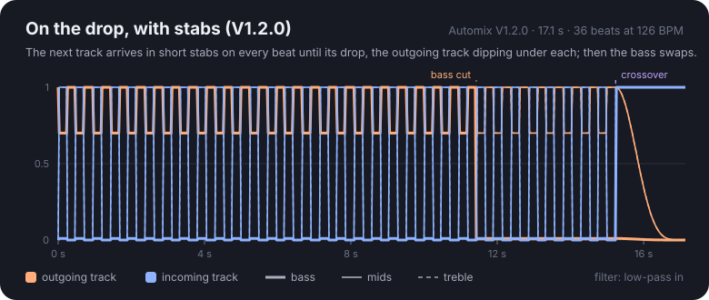

**Automix** is what makes a Songate playlist play like a DJ set. Each track is analysed once, on the console, while Songate measures its loudness: its tempo and beat grid, its bars and phrases, its key, where its bass drops in, how it starts and ends. When one track nears its end, Automix plans the join from both analyses (what kind, where it starts, how long, which curves) and Songate's player mixes the two on the exact sample. An **Automix playlist** goes further: Songate puts its songs in the order where they join best.

This repository is that code, as Songate runs it, as a small C++ library with no dependencies: **the analysis** (`mixan`), **the planner and the mixer** (`automix`), **every model** frozen so far, **the tools that trained them**, and examples you can run on any WAV file.

---

## ✨ Highlights

- 🥁 **On the beat, never stretched.** Joins meet on the beat only where the two tempos already meet. Automix never speeds a song up or slows it down: stretching was tried, and it was heard as distortion.
- 💥 **On the drop.** Where the tempos meet, the next song comes in without its bass, the bass swaps hard on its drop, and the first song is gone a bar later.
- 🌉 **Between tempos.** Where they don't, the next song's bass-less intro plays under the first song's last bars, then its drop takes over.
- 🎛️ **A DJ mixer.** Low and high shelves under the faders (−26 dB at most, as a DJ mixer's EQ), filter sweeps, an echo out, a gate for stabs, a loudness balance and a limiter, all on the console in real time.
- 🎼 **Keys.** Each track's key on the Camelot wheel. Clashing keys get a short join with the incoming harmony muffled.
- 🎓 **Trained by ear.** Each model after the first was tuned on rounds of blind demos rated 0 to 10 by a listener, from a real library of 3,074 songs.
- 🧊 **Frozen models.** A model never changes once it exists. A change makes a new one, and Songate can always go back.
- 📡 **Models over the air.** A model that only changes numbers is a small text file: Songate downloads it from this repository's releases, without an app update.

## 🎧 Listen

Three joins between made-up tracks ([`examples/make_tracks.py`](examples/make_tracks.py): no one's music), rendered by [`examples/render_join.cpp`](examples/render_join.cpp) with the code Songate plays, 12 s either side of each join:

- [**On the drop, V1.1.0**](../../releases/latest/download/drop-v1.1.0.mp3): 124 into 124 BPM; the next track bass-less for 8 bars, its bass in on its drop.
- [**On the drop, V1.2.0**](../../releases/latest/download/drop-v1.2.0.mp3): the same join, the next track in stabs on every beat until its drop.
- [**Timed, V1.2.0**](../../releases/latest/download/timed-v1.2.0.mp3): 124 into 96 BPM, too far apart for the beat: a smart crossfade.

Make them yourself with `python examples/make_tracks.py example-tracks`, then `build/render_join example-tracks/a-124bpm.wav example-tracks/b-124bpm.wav drop.wav models/automix-v1.2.0.model`.

## 🔬 The analysis

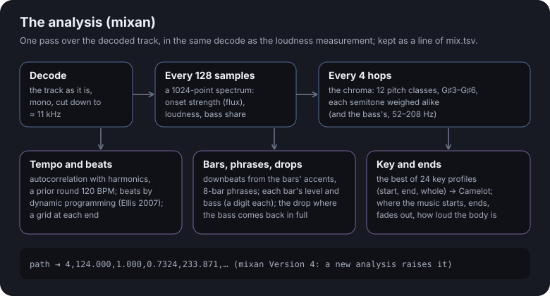

`mixan::Analyzer` takes the decoded track as it comes (`push` float samples, then `finish`) and returns a `mixan::Info`. Songate runs it in the same decode as its loudness measurement, so the whole library is read once. Everything is our own code: the good open beat trackers are GPL.

| What | How | In `mixan::Info` |
|---|---|---|
| **Onsets** | the mono signal cut down to ≈11 kHz; every 128 samples (≈11 ms) a 1024-point spectrum: the spectral flux of the log magnitudes, the frame's loudness and its share below 150 Hz | (internal) |
| **Tempo** | the onset strength's autocorrelation, with its harmonics, and a prior round 120 BPM | `bpm`, `confidence` |
| **Beats** | dynamic programming over the onsets (Ellis, *Beat tracking by dynamic programming*, 2007), then a grid fitted to the first and to the last minute: live music drifts | `beatIn`, `periodIn`, `beatOut`, `period` |
| **Bars** | the downbeat in each grid, from where the kick and the hi-hats fall and the snare does not (it is on 2 and 4), with how sure it is | `barIn`, `barOut`, `barSureIn`, `barSureOut` |
| **Phrases** | each bar's loudness; the 8-bar phrases start at the bar offset where the loudness changes most often (sections begin on phrase boundaries) | `bars` (a digit a bar), `phraseAt` |
| **Bass and the drop** | each bar's bass against the body's; the drop is the first beat where the bass jumps by 8 dB or more and stays full for four bars (a build-up that grows slowly is passed over) | `bass` (a digit a bar), `dropAt`, `dropJump`, `bassIn`, `bassOut` |
| **Key** | the chroma (12 pitch classes, G♯3 to G♯6, each semitone weighted alike) summed over a stretch, against Krumhansl and Kessler's profiles of the 24 keys; the best correlation wins and its lead over the second says how sure it is; of the whole track and of its first and last minute | `key`, `keyIn`, `keyOut`, `keySure` |
| **Ends** | the first and last moment above the quiet floor, where a fade-out starts, where the intro reaches the body's level, how loud the body is | `start`, `end`, `fadeStart`, `introEnd`, `level` |

Songate keeps it as one line of `mix.tsv` per track (`Info::pack`, `Info::unpack`). **`mixan::Version`** (4 today) is the analysis's version: a change to what is measured raises it, and Songate analyses the library again. Every model then runs on the new analysis too.

## 🔀 The joins

`automix::plan(a, duration, b, fallback, nullptr, model)` returns a `Plan`: where in track A the join starts (`startOut`), where track B starts (`offset`, on its first beat or where its music begins), how long it lasts, and what each curve does. `automix::Fader` then mixes the two (Songate's player runs it on the audio thread; `automix::render` and the tools render a join to a file with the very same code). These are real joins from a real library, drawn from the mixer's own numbers by [`tools/curves.cpp`](tools/curves.cpp):

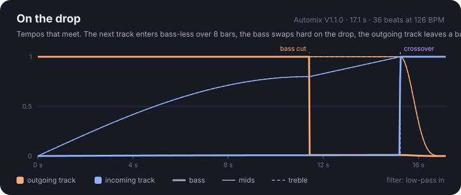

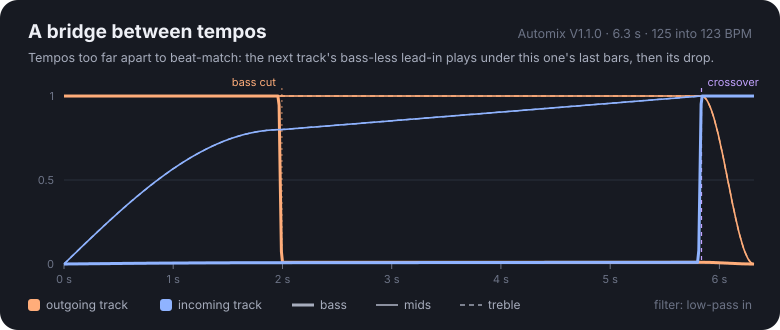

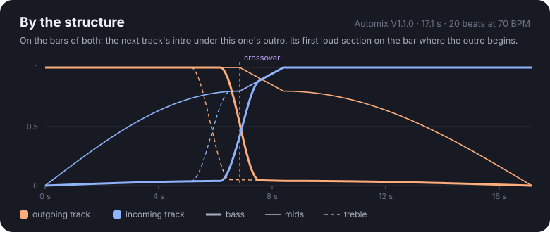

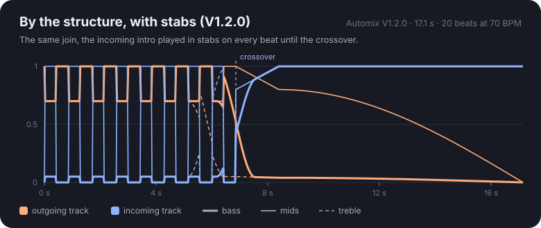

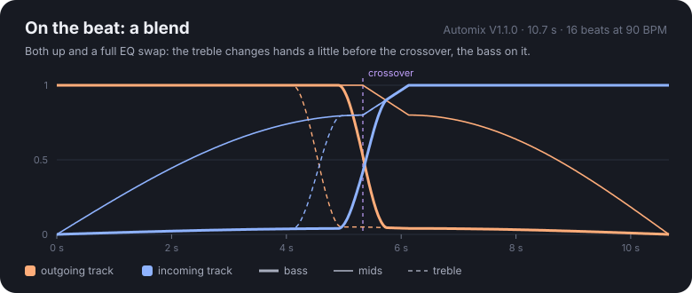

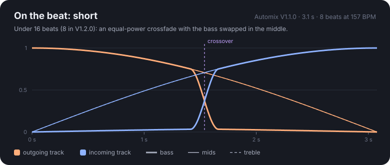

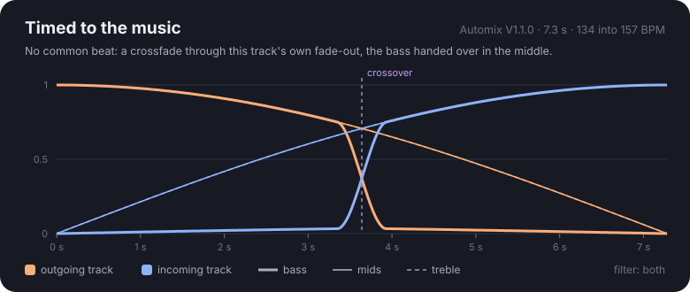

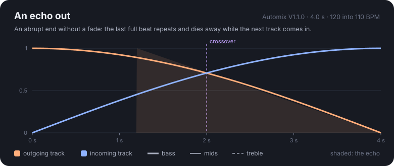

**How Automix chooses**, in this order:

1. **On the drop** when both beat grids are sure, the tempos meet as they are (a beat of each within 20 ms over the whole join) and track B has a drop: B comes in without its bass 8 bars before its drop, A's bass is cut hard on a bar line a quarter of the way before the drop (a bridge with no bass at all), B's bass comes in on its drop, and A is gone a bar later on a steep curve.
2. **A bridge into the drop** when B has a drop but the tempos do not meet: B's lead-in, up to 8 bars, under A's last bars, without trying to match beats.
3. **By the structure** when both have sure bars: A's outro begins after its last loud bars; B starts so that its intro plays under that outro and its first loud section lands on the bar where the outro begins. Lows and highs change hands there.
4. **On the beat** when the tempos meet: 32, 16 or 8 beats, both up with a full EQ swap from 16 beats (8 in V1.2.0), a smooth crossfade with a bass swap below that.
5. **Timed to the music** otherwise: through A's own fade-out; after an abrupt end, an echo of its last full beat; never skipping A's music (the change lands where A starts to fade out, or at its end).

**Keys:** when both keys are sure and they are 3 or more steps apart on the Camelot wheel, the join is kept short and B's harmony is muffled by a low-pass until the crossover. **The mixer:** each voice through a low shelf (200 Hz) and a high shelf (2.5 kHz) under its volume; filter sweeps (B low-passed from 1 kHz up to 20 kHz, A high-passed away); the echo (a delay line fed by A until it stops, then only its own repeats); the gate (V1.2.0: B in stabs of half a beat on every beat, at full level, A dipped 3 dB under each); a loudness balance so two songs at once are no louder than one; a limiter that keeps every 16-frame block under −0.5 dBFS.

## 🧮 Scoring a join, ordering a playlist

An Automix playlist is ordered as Vande Veire and De Bie's track lister orders a DJ set: every pair of songs gets a score (`automix::joinScore`) from the join Automix would make between them, then the order with the best joins overall is searched for.

| The join it would be | Score |
|---|---|
| on the drop | 6 |
| by the structure | 4.5 |
| on the beat and on the bars | 3.5 |
| on the beat | 3 |
| a bridge into the drop (tempos apart) | 3 |
| a cut on a phrase (tempos apart; V1.0.0 only) | 2 |
| timed | 0 |
| **keys**, when both are sure: the same, a neighbour, two apart, more | +0.75, +0.5, 0, −0.5 |
| **off the beat**: tempos far apart (a bridge or a cut: at most −1.5; a fade: at most −3) | −10 × the tempo gap |
| **a timed join**: a fade-out of 2 s or more, a quiet intro of 4 s or more | +0.5 each |
| ties broken by how near the tempos are | −0.01 per BPM |

The order (`automix::order`): a greedy path from up to 64 starting songs (fewer for a long playlist, to stay quick on the console), each improved by moving one song at a time to where the path gains most, while it gains; the best path wins. A song can be pinned to play first. Every model so far orders with V1.0.0's score: the order the later models were trained on.

## 🎓 Training a model

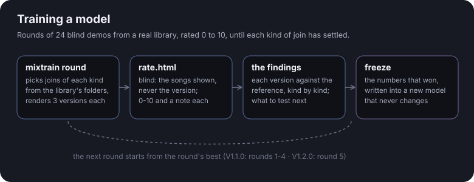

`tools/mixtrain.cpp` makes a round of 24 demos: from a library's folders ordered as Automix playlists, it picks joins of each kind and renders each three ways, the reference and two versions that differ *as heard* (the timing, the exit, the gate: not numbers a join of that kind never reads). `tools/mixtrain-page.py` writes a rating page: blind (the songs shown, never the version), a player per demo with its join marked, 0 to 10 and a note. The ratings show what to keep and what to test next, kind by kind.

| Round | Demos | Average | What it settled |
|---|---|---|---|
| 1 | 24 | 4.4 | the kind of join decides most; "too early" was music skipped; the incoming low-pass from 1 kHz |
| 2 | 24 | 4.96 | never a cut between tempos; no music skipped; shorter overlaps |
| 3 | 24 | 5.46 | on the drop the outgoing song gone a bar after it; a timed fade's length as it was |
| 4 | 24 | 7.0 | the outgoing exit on a drop (cos⁵); bridges as they were; stabs liked, "louder" → **V1.1.0 frozen** |
| 5 | 24 | 6.4 | stabs on every beat on drops and structured joins; a longer blend on the beat → **V1.2.0 frozen** |

Round 5's tens, as the listener wrote them:

| Join | Kind | What it played | The note |
|---|---|---|---|
| idfc → Fatal | on the drop | V1.2.0's stabs on every beat | "I'm mindblown right now" |
| The way (remix) → Reckless (remix) | by the structure | V1.2.0's stabs on every beat | "Crazy DJ stuff right here" |
| Light It Up → Hometown | on the beat | V1.1.0, and both versions | "We might need to create a bigger scale" |
| Cosmic Pathways → Nami | on the drop | V1.1.0, and the louder stabs | "So seamless I still don't know which music is which" |

**The rules.** A model never changes once it exists: a change copies the newest model into a new one, and the copy changes. A model that needs a new analysis raises `mixan::Version` (the library is analysed again, and the older models run on the new analysis too). Every new model is checked against the old ones, join by join, before it is frozen.

## 🧑‍🔬 Train a model of your own

The same method, from your own library, with nothing to program: a round is a small text file, the ratings are read for you, and the model you freeze plays in your Songate. Build the tools first (with FFmpeg, and `ffmpeg` on your PATH for the demos: see Building, below).

**1. Analyse your library once.** About 7 minutes for 3,000 songs; run it again after adding music (it resumes).

```
build/mixtrain analyse "D:/Music" library.tsv
```

**2. Write a round.** Copy [`examples/training/round-1.spec`](examples/training/round-1.spec) and change it. It names the model you start from (`base`), how many joins of each kind to hear (`joins drop 2`: drop, bridge, structure, beat, fade), and for each kind two versions, each changing one or two numbers of the model file (`version drop 1 exitBars 2`). A version that would sound exactly like the reference on some join is never wasted: that join is passed over for another, or the version gives way to its `alternative`.

**3. Make the demos.** Each join becomes three demos (the base and its two versions), shuffled, about 20–40 s each.

```
build/mixtrain build library.tsv my-round-1.spec rounds/round-1
python tools/mixtrain-page.py rounds/round-1
```

**4. Rate them.** Open `rounds/round-1/rate.html` in a browser (if a browser will not play its audio from the file, serve the folder: `python -m http.server` in `rounds`, then open `localhost:8000/round-1/rate.html`). It shows the two songs of each demo, never which version it is. Rate 0 to 10, write a few words when something stands out ("too early", "too much overlap": they matter as much as the numbers), then **Save the ratings** and put `ratings-round-1.json` in the round's folder.

**5. Read what they say.**

```
python tools/mixtrain-fit.py rounds/round-1 [rounds/round-0 …]
```

For every kind of join, each version against its own join's reference, the numbers it changed, the mean, and your notes beside them; across all the rounds given, each number **SETTLED** (tried on 4+ joins, better on three quarters of them, at least +1 on average: `--settled`, `--share`, `--gain` change that), **not yet**, or **worse**. It writes the report to `fit-round-1.md` and the settled numbers to `candidate-round-1.txt`. Nothing is decided for you: write the next round from what is not settled yet, and edit the candidate if you disagree with it.

**6. Freeze your model** when the kinds you care about have settled:

```
build/mixtrain freeze rounds/round-3/candidate-round-3.txt "My Automix 1" library.tsv my-automix-1.model
```

It refuses a file or a name that exists (a model never changes), and says what the new model changes on your library, kind by kind ("drops: 915 joins, now in stabs").

**7. Hear it on your console.** Copy the file to `sdmc:/config/gatefold-nx/models/` and choose it in Songate's Settings › Updates › Automix models; going back to the built-in model is one press. To share it, open a pull request with the model file, your round specs, ratings and fit reports (no audio).

**A good round:** two to four joins of each kind you want to improve; versions that each change one or two numbers; the weak joins of the last round heard again (`retest`); rated in one sitting, with headphones or good speakers, writing notes. Ratings from one listener are noisy: a number is worth freezing only once it has held over several joins.

## 📦 The models

| Model | Frozen | What it is | Where |
|---|---|---|---|
| **V1.0.0** | 2026-10-29 | Automix as hand-written: joins on the drop, bridges and cuts between tempos, no tempo change | built in (`namespace v1_0_0`) |
| **V1.1.0** | 2026-10-29 | the first trained model (rounds 1–4): no cuts, no music skipped, shorter overlaps, a softer exit | built in (`namespace v1_1_0`) and [`models/automix-v1.1.0.model`](models/automix-v1.1.0.model) |
| **V1.2.0** | 2026-10-30 | round 5: stabs on every beat on drops and structured joins, longer blends on the beat | [`models/automix-v1.2.0.model`](models/automix-v1.2.0.model), the first model sent over the air |

V1.1.0's file plans exactly as the built-in V1.1.0: all 3,029 joins of the training library's folders, every field the same (`tools/mixtrain filesame`), and byte for byte the same audio. V1.2.0's file plans exactly what round 5 rendered for each kind of join.

## 📄 The model file

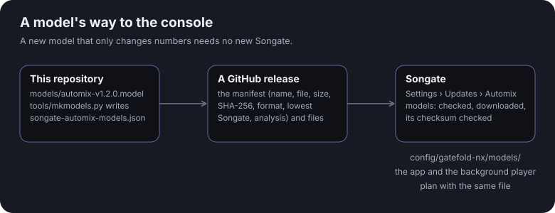

A model that only changes numbers is a text file (`automix::ModelFile`), a `key value` line each:

```
songate-automix-model 1        the format: the planner it needs
name Automix V1.2.0
app 2.0.0-beta                 the lowest Songate that reads it
mixan 4                        the analysis it was trained on
order 1.0.0                    whose playlist order it uses
gateOn drop,structure          the kinds of join the gate plays on
dropBars 8                     … then every number of automix::Tune
exitBars 1
outPow 5
gate 1
gateEvery 1
clashBeats 16
beatMaxSec 32
…
```

**Format 1** is planned by `namespace file1`: the trainable planner as it stood when V1.2.0 was frozen, copied so that it never changes. A file of a newer format, trained on a newer analysis, or with a number this format does not know is refused. **A model that needs new logic (a new kind of join) needs a new format, and one that needs a new analysis a higher `mixan::Version`: both come with a Songate update.**

`tools/mkmodels.py` writes the release's manifest, `songate-automix-models.json`:

```json
{ "format": 1, "models": [ { "name": "Automix V1.2.0", "file": "automix-v1.2.0.model", "size": 377,
  "sha256": "…", "format": 1, "app": "2.0.0-beta", "mixan": 4, "date": "2026-10-30", "notes": [ "…" ] } ] }
```

## 📲 How Songate uses it

- **The analysis** runs on the console with the loudness measurement, once per track, on a worker; `mix.tsv` keeps it.
- **The joins** are planned when a track has played ten seconds; the next track is opened at its offset on a worker a few seconds ahead, and the player starts it on its exact sample. Songate's join animations (the frosted cover, the hint, the colours) follow the plan.
- **The background player** (a sysmodule, which keeps the music going on the HOME menu and in games) builds in the same `automix.cpp`: an Automix playlist joins there too, from the same `mix.tsv` and the same model, in 1.5 MB of memory.
- **Models over the air:** Songate's update check reads `releases/latest/download/songate-automix-models.json` here, offers a model it can play ("Automix V1.2.0 is available"), downloads it, checks its size and SHA-256, and keeps it in `config/gatefold-nx/models/`. Settings › Updates › Automix models switches between the downloaded models and the built-in one.

## 🛠️ Building

A C++20 compiler and CMake. Nothing else for the library, the examples and the test:

```
cmake -S . -B build -DCMAKE_BUILD_TYPE=Release
cmake --build build
ctest --test-dir build
```

The training tools decode MP3, M4A, FLAC and the rest through FFmpeg:

```
cmake -S . -B build -DSONGATE_AUTOMIX_TOOLS=ON -DFFMPEG_DIR=<an FFmpeg build with include/ and lib/>
```

(or with FFmpeg's development packages installed, without `FFMPEG_DIR`: pkg-config finds them). Tested with clang on Windows; the code is the console's, so GCC and Linux are expected to work.

## ▶️ Running

```
python examples/make_tracks.py example-tracks        three made-up dance tracks (no one's music)
build/analyse example-tracks/a-124bpm.wav             what the analysis measures
build/plan_join example-tracks/a-124bpm.wav example-tracks/b-124bpm.wav models/automix-v1.2.0.model
build/render_join example-tracks/a-124bpm.wav example-tracks/b-124bpm.wav join.wav
build/model_info models/automix-v1.2.0.model          whether this build plans a model, and its numbers
```

The tools: `mixtest --render a b out.wav` (any two files, as Songate plays the join; `AUTOMIX_MODEL=1.0.0` or a `.model` file), `mixtest --plans <folder>` (every join of a folder ordered as an Automix playlist), and for training (above) `mixtrain analyse`, `mixtrain build`, `tools/mixtrain-fit.py`, `mixtrain freeze`, `mixtrain filesame <cache.tsv> <file>.model` (a model file against what it stands for). `mixtrain round` is how Songate's own rounds were made.

## 🤝 Contributing

Issues and pull requests are welcome, above all rated rounds: a round from your own library is the best way to make the next model better. The rules: never change a frozen model (`v1_0_0`, `v1_1_0`, `file1`, a published `.model`); a new model gets a new name and file; a change to the analysis raises `mixan::Version`; check a new model with `mixtrain filesame` and `ctest`. Songate itself lives at [AndryTheBeast/Songate](https://github.com/AndryTheBeast/Songate): its copy of these files is the source of truth, kept in step with this repository by its `tools/automix/sync-automix.py`, which refuses any change to a frozen model.

## 📜 Licence

MIT: see [LICENSE](LICENSE).

## 🙏 Credits

Vande Veire and De Bie's automatic DJ (the track lister and the "both up" join), Ellis's beat tracking by dynamic programming (2007), Krumhansl and Kessler's key profiles, the Camelot wheel, and Spotify's mixes, measured to learn what a join on the drop does.

## 👥 Author

[AndryTheBeast](https://github.com/AndryTheBeast)
